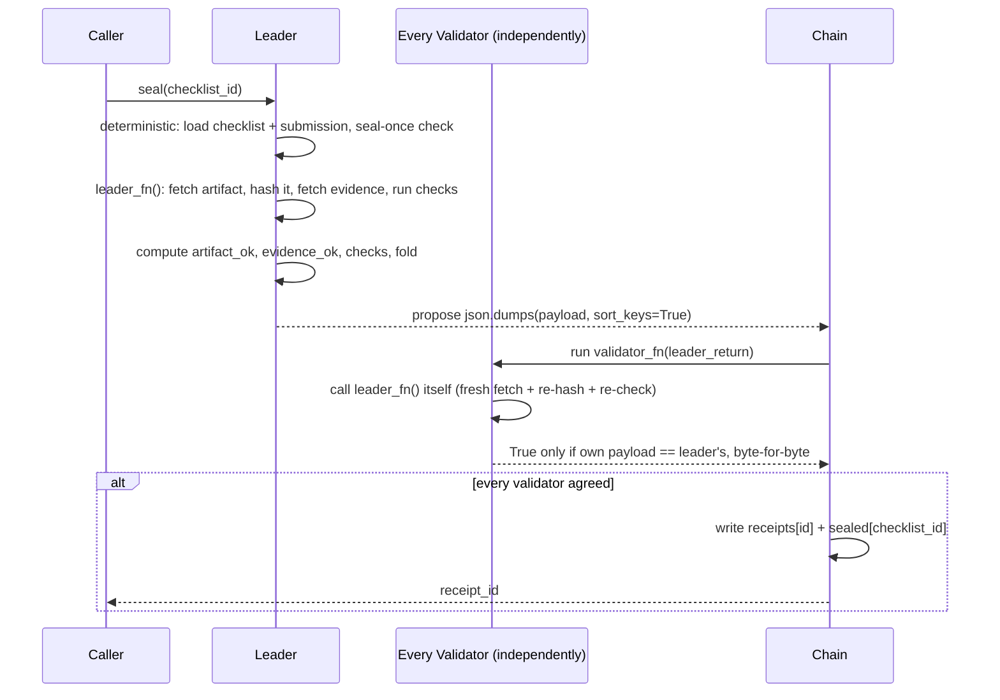

# ArtifactChecklistReceipt

A standalone [GenLayer](https://genlayer.com) Intelligent Contract primitive that **seals a structured checklist together with a pinned artifact, and issues a receipt only when every validator independently re-fetches and re-hashes that artifact, independently re-fetches every declared evidence source, and re-runs the same deterministic checks.**

It answers one narrow, checkable question — *"does this exact artifact, right now, satisfy this exact checklist?"* — without any model judgment, any confidence percentage, or any leader-trust shortcut.

> **Deployed and proven live:** `DEPLOY_ADDRESS_PLACEHOLDER` on GenLayer Studio Devnet. Three finalized transactions opened this repository's own checklist, pinned a committed artifact by SHA-256, and issued `receipt-0` with fold `met`. Details below.

## The trust problem it closes

A contract that wants to attest "this artifact passed this checklist" has two ways to get it wrong:

1. **Validator only checks the shape of the leader's answer.** If a validator accepts a well-formed JSON blob without re-fetching and re-hashing the artifact itself, the leader can fabricate any outcome. This contract's validator never does that — it calls `leader_fn()` itself (a completely fresh fetch + re-hash + re-evaluation) and compares its own normalized payload byte-for-byte against the leader's.
2. **A quantitative or prose outcome not exactly agreed on.** A score, a confidence band, a "mostly-compliant" tier, or an LLM reading a paragraph all let two honest nodes diverge. This contract compares only booleans, strings, JSON numbers, and one SHA-256 digest. Identical observations always produce an identical payload.

## What it does

A caller first **opens a checklist** (`open_checklist`):

| Checklist field | Meaning |
|---|---|
| `schema` | must be `"acr.checklist.v1"` |
| `title` | 1–80 characters |
| `evidence` | 0–2 `{url, needle}` sources; each `url` an `https://` URL with no embedded credentials; `needle` ≤ 256 characters |
| `checks` | 1–8 checks over the artifact |

Each check is one of:

| `kind` | Fields | Passes when |
|---|---|---|
| `json_path_eq` | `path`, `expect` | the value at `path` is a string equal to `expect` |
| `json_number_gte` | `path`, `min` | the value at `path` is a JSON number ≥ `min` |

`path` is a dot-separated path into the decoded artifact JSON (`build.tags.0` walks a list). Unknown fields are rejected at every level, so a stored checklist is exactly the schema it claims to be.

Then a caller **submits the artifact** (`submit_artifact(checklist_id, artifact_url, artifact_sha256)`) — one `https://` URL plus its expected 64-hex SHA-256. Exactly one submission is allowed per checklist.

Finally a caller **seals** the checklist (`seal(checklist_id)`). Every node — leader *and* every validator, independently — re-fetches the artifact bytes, re-hashes them, re-fetches each evidence source, and re-runs every check against the freshly fetched artifact. Only a payload every validator independently reproduces is accepted, and the receipt records the resulting fold.

### The fold

The fold is a pure function of two booleans and the check results. No model, no partial credit.

| Condition | Fold |
|---|---|
| artifact digest matches, every evidence source fetched OK, all checks pass | `met` |
| artifact digest matches, every evidence source fetched OK, at least one check fails | `unmet` |
| the artifact failed to fetch / exceeded its size bound / hashed to a different digest, or any evidence source failed | `unresolved` |

`unresolved` is deliberately *not* a decision, but sealing is once-only: the receipt is written for **every** fold, and after it exists no second `seal` for that checklist is accepted. This keeps each checklist's outcome immutable.

### The checks

| Check | Computed as |
|---|---|
| `artifact_ok` | freshly fetched bytes are ≤ 5,000,000 bytes and their SHA-256 equals the pinned digest |
| `evidence_ok` | every evidence source returned 2xx within 12,000 bytes and (if a needle was given) contains it |
| each check | `json_path_eq` / `json_number_gte` evaluated over the freshly decoded artifact JSON |

The artifact is only ever interpreted as structured JSON at explicit paths, and evidence needles are plain substring tests. No prose is ever interpreted, so text in an artifact or evidence source cannot change how a check evaluates.

## Contract interface

| Method | Kind | Description |
|---|---|---|
| `open_checklist(checklist_json: str) -> str` | write | Validate and persist a checklist; returns its `checklist_id` (`cl-0`, `cl-1`, …) |
| `submit_artifact(checklist_id: str, artifact_url: str, artifact_sha256: str) -> str` | write | Pin one artifact (URL + expected SHA-256); returns the `checklist_id` |
| `seal(checklist_id: str) -> str` | write | Re-fetch, re-hash, and re-check under independent re-execution consensus and issue a receipt; returns its `receipt_id` |
| `get_checklist(checklist_id: str) -> str` | view | Normalized checklist JSON |
| `get_submission(checklist_id: str) -> str` | view | Submitted artifact binding JSON |
| `get_receipt(receipt_id: str) -> str` | view | Full receipt JSON (fold, digest, check results, `submitted_by`) |
| `get_checklist_count() -> u256` | view | Total checklists ever opened |
| `get_receipt_count() -> u256` | view | Total receipts ever issued |

## How consensus actually works here



Because `leader_fn` and `validator_fn` each do their own fetch, their own hashing, and their own check evaluation, and because the validator's only input from the leader is the payload *string* it compares against its own independently derived string, there is no code path where a well-formed but fabricated leader payload is accepted.

## Repository layout

```
contracts/ArtifactChecklistReceipt.py         the contract
tests/direct/                                  gltest direct-mode test suite (56 tests)
scripts/live_smoke.py                          optional live open/submit/seal reproduction (key via env)
docs/DESIGN.md                                 design rationale, non-determinism boundaries, threat model
docs/EXAMPLE_ARTIFACT.json                     the artifact pinned by the live demonstration
docs/EXAMPLE_EVIDENCE.txt                      the evidence source used by the live demonstration
docs/WHY_THIS_PASSES_REVIEW.md                 mapping against known Portal rejection patterns
PORTAL_SUBMISSION.md                           submission text for the GenLayer Portal
SECURITY.md                                    scope and vulnerability reporting
CHANGELOG.md                                   release history
.github/workflows/ci.yml                       lint + validation + direct tests on every push
```

## Testing

The suite runs the contract in gltest's direct mode with mocked web responses — no network, no live node required.

```bash
pip install -r requirements-test.txt
# Pin the genvm-manager release whose bundle ships the runner named in the header:
export GENVM_VERSION=v0.6.0-rc8          # PowerShell: $env:GENVM_VERSION="v0.6.0-rc8"
genvm-lint check contracts/ArtifactChecklistReceipt.py
genvm-lint validate contracts/ArtifactChecklistReceipt.py
gltest tests/direct/test_artifact_checklist_receipt.py -v
```

56 direct-mode tests cover: the full checklist-validation surface (schema, title, evidence, checks, ids, paths, kinds), the submission rules (unknown checklist, duplicate, URL and digest bounds), the `met` happy path, every check-driven `unmet` path (mismatch, below-minimum, missing path, non-string comparison, non-JSON artifact), every `unresolved` path (digest mismatch, HTTP error, absent fetch, artifact too large, evidence HTTP error, absent evidence, missing needle, evidence too large), the seal-once rule (blocked after `met`, `unmet`, and `unresolved`), a dishonest-leader disagreement and a leader-error disagreement, two checklists, the view error surface, and the pure deterministic helpers. `genvm-lint check` passes with zero warnings and `genvm-lint validate` passes semantic validation.

## Live deployment on GenLayer Studio Devnet

LIVE_DEPLOYMENT_PLACEHOLDER

The same procedure is reproducible with [`scripts/live_smoke.py`](scripts/live_smoke.py), which takes the signing key from the `ACR_PRIVATE_KEY` environment variable and never stores a secret in the repository.

## A note on the SDK header

The contract keeps the canonical GenLayer header exactly:

```
# v0.3.0
# { "Depends": "py-genlayer:5jycge4q8k23462jtb0b9fyey1s9qz928sz2nbrd9mg4sxqg2qng" }
from genlayer import *
```

Under the pinned runner, `from genlayer import *` no longer re-exports the `gl` namespace (that alias existed only in the older `genlayer.gl` layout), so the contract adds `import genlayer as gl` and imports `TreeMap` from `genlayer.storage` explicitly. See [docs/DESIGN.md](docs/DESIGN.md#10-sdk-layout-notes) for the exact reasoning, and `Storage` below.

## Storage

All state is JSON strings plus two `u256` counters:

| Field | Type | Purpose |
|---|---|---|
| `checklists` | `TreeMap[str, str]` | `checklist_id` → normalized checklist JSON |
| `submissions` | `TreeMap[str, str]` | `checklist_id` → artifact binding JSON |
| `receipts` | `TreeMap[str, str]` | `receipt_id` → receipt JSON |
| `sealed` | `TreeMap[str, str]` | `checklist_id` → `receipt_id` (the seal-once index) |
| `checklist_counter` | `u256` | checklists opened |
| `receipt_counter` | `u256` | receipts issued |

Generic storage classes are allocated from their bare annotations by the SDK; only the two scalar counters are assigned in `__init__`. There are no funds, no reputation, no scores, and no privileged roles anywhere in the contract.

## License

[MIT](LICENSE)
